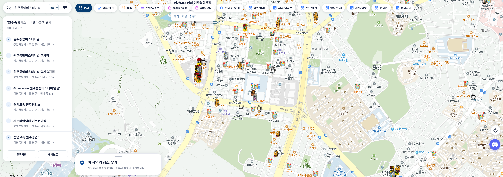
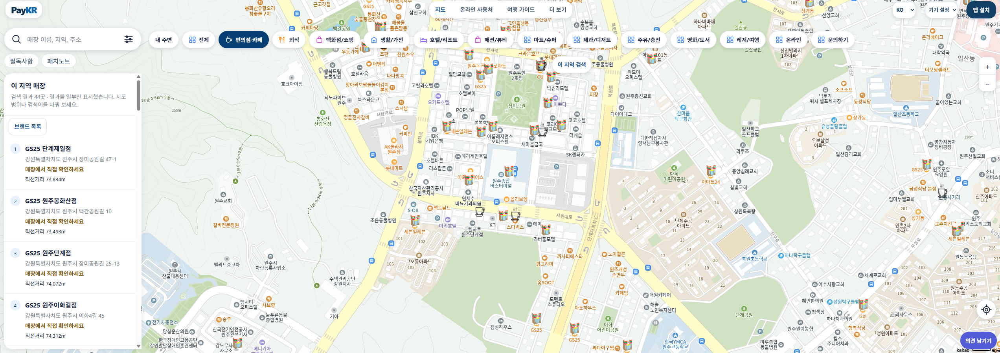
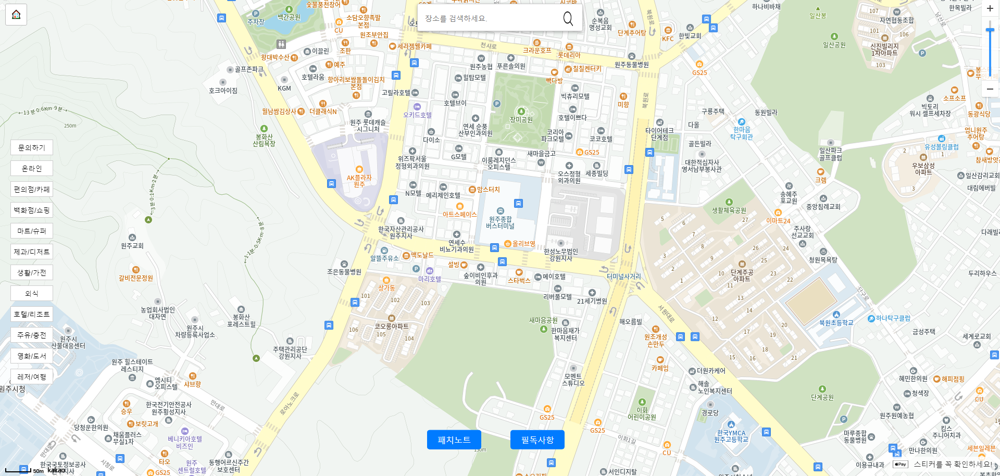
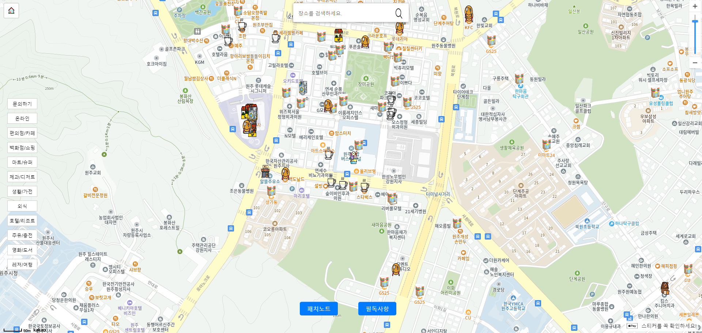
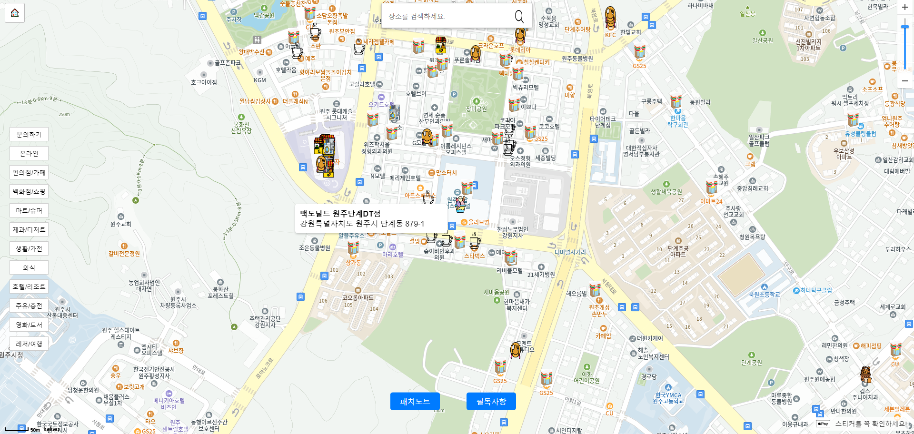
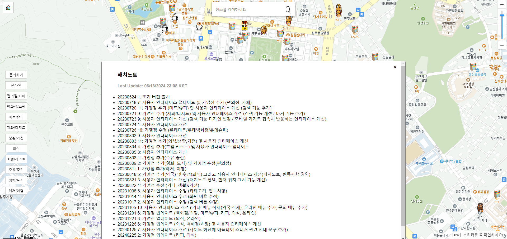
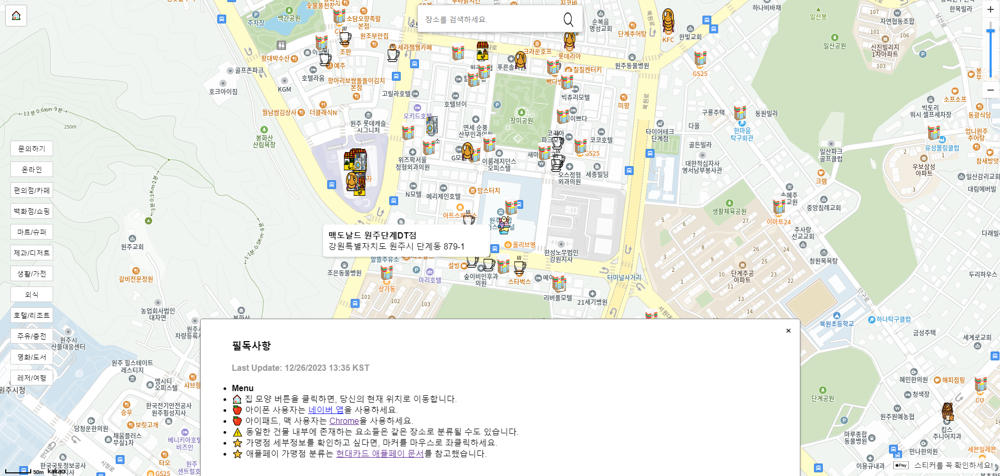
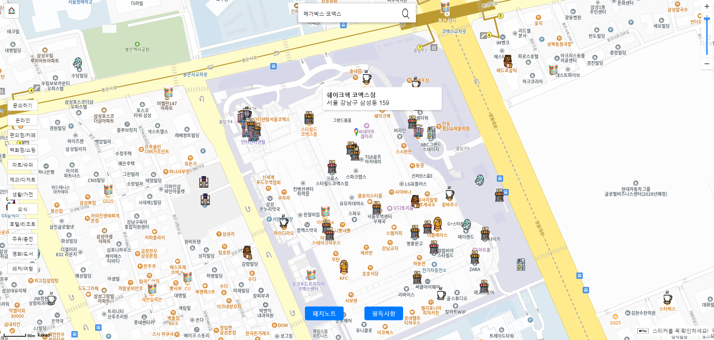
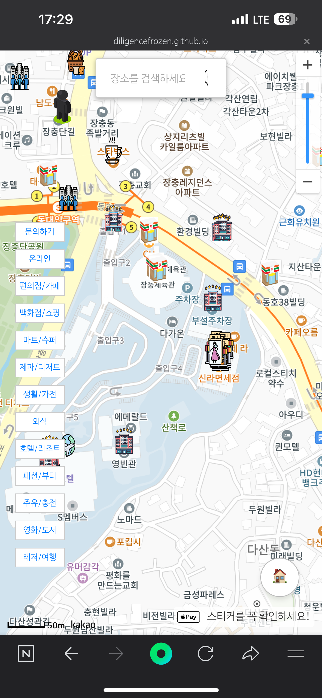

 

" />
## Purpose
- **Convenience**: No need to install a separate app to find stores that support Apple Pay.
- **Accessibility**: Quickly locate Apple Pay supported stores from anywhere, at any time.
- **Accurate Information**: Store information is regularly updated to ensure it's always current.
  
## Why Use ASM(Apple Pay South Korea Map)?
1. Convenience: No extra app needed. Quickly find Apple Pay–supported shops.
2. Accessibility: Locate participating stores anytime, anywhere.
3. Accuracy: Store details are frequently updated so you get the most current info.

## How to Use the Map
1. Open the site in your browser.
2. Pick a category (convenience stores, cafes, etc.) from the map.
3. Click a marker to see store details.
   
## Feedback & Suggestions
- Want to add or update a store, or share other ideas?
- Head over to My [GitHub Issues](https://github.com/diligencefrozen/PayKR/issues) page and let me know!

## Screnshots
### PC 

 

 

 

 

 

 

 

### Mobile

 

## Mobile map UI and Discord chat

The map uses the existing Kakao merchant searches with a horizontal category bar,
keyboard-submit search, and a draggable/clickable place sheet. The sheet contains
search results on mobile and place details, phone, reviews and directions when a
place is selected. Chat opens independently without resetting map or place state.
The old `/forum/` entry redirects to `index.html?chat=open`; legacy forum source
and external user data are retained, but the map no longer links to that UI.

Discord uses [official WidgetBot Crate](https://docs.widgetbot.io/embed/crate/tutorial)
with server `1574706452671504474` and channel `1574706454353412239`.
Position updates use the documented `location`/`setOptions` APIs. No paid embed
CSS or guest authentication is configured. On narrow phones, the official widget
opens full screen, so its appearance differs from the supplied design mockup.
If the CDN fails, a direct Discord channel link is shown.

For local preview, run `python3 -m http.server 8765 --bind 127.0.0.1` and open
`http://localhost:8765/?lang=ko`. The Kakao app must allow that web origin.
On 2026-11-24 the existing key returned HTTP 401 `domain mismatched` for this
origin; live map/search/location regression checks therefore require an allowed
origin. Do not replace the production key just for preview.

Run the dependency-free behavioral checks with `node tests/map-ui.test.mjs`.
These use mocked Kakao services and cover duplicate initialization, stale category
responses, marker selection/deselection, sheet gestures, mobile search results,
plain-text place rendering and Crate initialization/state preservation.
Browser checks covered 390px mobile and 1280px desktop layouts, filter and sheet
controls, and loading the actual `Lab` / `general` Discord channel. Sending a chat
message and authenticated Discord access have not been tested.

## Language, directory and ad previews

Both pages use the same KO / EN selector. A valid `?lang=ko` or `?lang=en`
takes precedence over the saved choice and browser language. Store names and
addresses supplied by Kakao retain their original spelling. When the map opens,
it requests the browser's location and searches the confirmed viewport for
convenience stores, cafés, supermarkets, bakeries and dessert shops, and restaurants.
Users can retry with the location button or explore manually. A failed request
leaves the map and any previously confirmed location marker in place.

Appearance defaults to the device setting. Choose Light, Dark or System in the
map's category panel or next to the online directory heading. Both pages share
the saved choice. The map hides the Discord control while the category panel is open.

Open `/online.html` to search the 36 original entries using their Korean names,
English names or aliases. Search and category filters apply together.

Add `?adpreview=1` to either page to inspect non-interactive placement outlines.
The map has a desktop sidebar placement and a mobile placement after the
selected place's details. The directory has placements above, within and below
the list. Short result lists suppress the middle and lower placements.
Ordinary visits collapse these spaces. Each page loads the supplied AdSense
site connection script once. Manual ad units require IDs issued by AdSense.
Review automatic formats and page exclusions in the publisher account before
enabling them on the map.

Run `node tests/map-ui.test.mjs` and `node tests/directory.test.mjs` for the
offline regression checks. The screenshots in `ss/paykr-*.png` show the local
Chrome preview. The map screenshots show controls without Kakao tiles, and the
mobile place panel uses test data.
